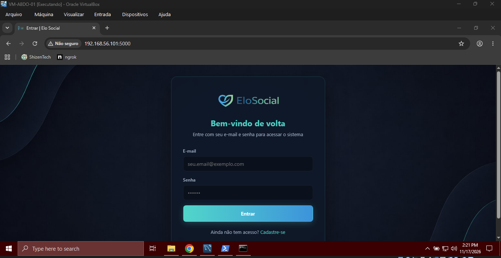
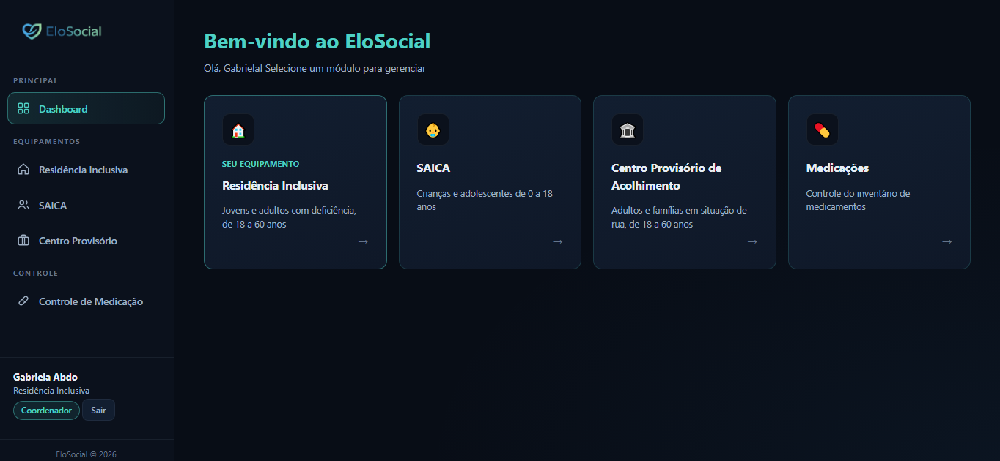
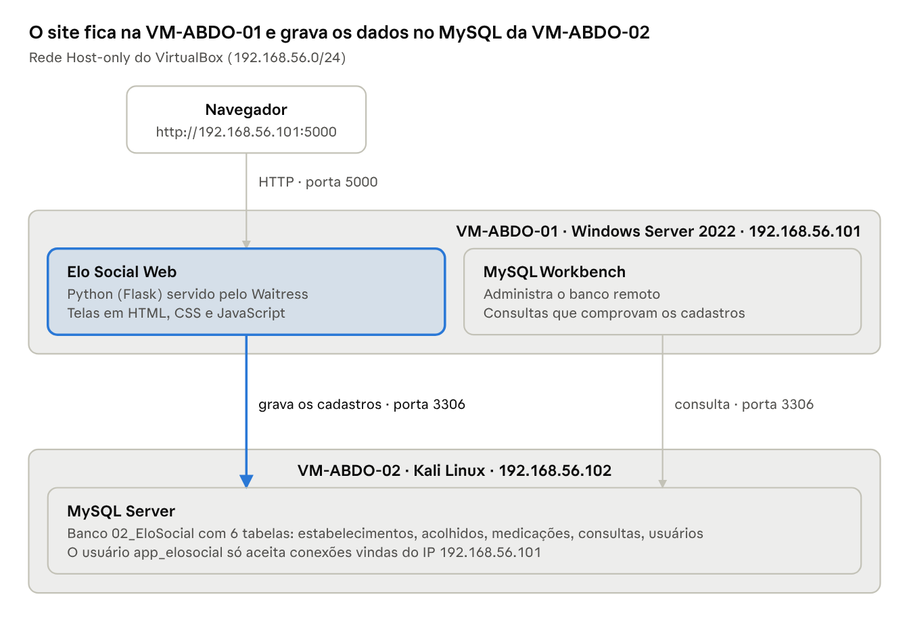
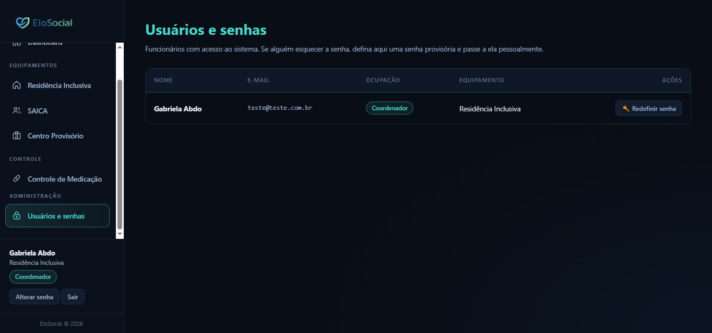

# Elo Social v2.0

Sistema de gestão para residências de acolhimento social do município de Taboão da Serra: **Residência Inclusiva (RI)**, **SAICA** e **Centro Provisório de Acolhimento (CPA)**. Centraliza o cadastro de acolhidos, o controle de medicações e a agenda de exames e consultas.

A versão 1.0 funcionava no terminal, em Python. A **versão 2.0** é um site acessado pelo navegador, com login de funcionários e permissões por ocupação.



## O que há de novo na v2.0

- Interface web em HTML, CSS e JavaScript
- Cadastro de funcionários com login e senha
- Quatro ocupações com níveis de acesso diferentes
- Alterar senha e redefinição de senha pelo Coordenador
- Senhas gravadas como hash (scrypt), nunca em texto puro

| Ocupação | Ler | Inserir | Alterar | Excluir |
|---|:---:|:---:|:---:|:---:|
| Coordenador | ✔ | ✔ | ✔ | ✔ |
| Assistente Social | ✔ | ✔ | ✔ | ✘ |
| Psicólogo | ✔ | ✔ | ✔ | ✘ |
| Cuidador | ✔ | ✘ | ✘ | ✘ |



## Tecnologias

- **Backend:** Python 3.11, Flask e Waitress
- **Banco de dados:** MySQL 8.4 (`mysql-connector-python`)
- **Interface:** HTML, CSS e JavaScript

## Como executar

1. Crie o banco executando `banco/elosocial-bd.sql` no MySQL (pelo MySQL Workbench, por exemplo). Antes, ajuste no final do script o IP e a senha do usuário da aplicação.
2. Copie `config.exemplo.ini`, renomeie a cópia para `config.ini` e preencha o IP do banco, o usuário e a senha.
3. Instale as bibliotecas:
   ```
   pip install -r requirements.txt
   ```
4. Inicie o site com dois cliques em `iniciar-elosocial.bat` (ou `python app.py`).
5. Acesse `http://localhost:5000` (ou o IP da máquina, pela rede) e crie o primeiro usuário em **Cadastre-se**.

O passo a passo completo, com a instalação em duas máquinas virtuais, está em [`INSTRUCOES.md`](INSTRUCOES.md).

## Implantação em duas máquinas virtuais (AC4)

Na atividade AC4 – Desafio Final, da disciplina Server and Data Center Administration, a aplicação foi hospedada em um **Windows Server 2022** e o banco de dados em um **Kali Linux**, cada um em sua máquina virtual, comunicando-se por uma rede Host-only.





## Autoria

Projeto acadêmico do curso de Análise e Desenvolvimento de Sistemas da UniFECAF, Taboão da Serra, 2026.

- **Versão 1.0 (Projeto Integrador):** Gabriela Abdo e Misael Dias Caboclo
- **Versão 2.0 (AC4 – Server and Data Center Administration):** Gabriela Abdo
